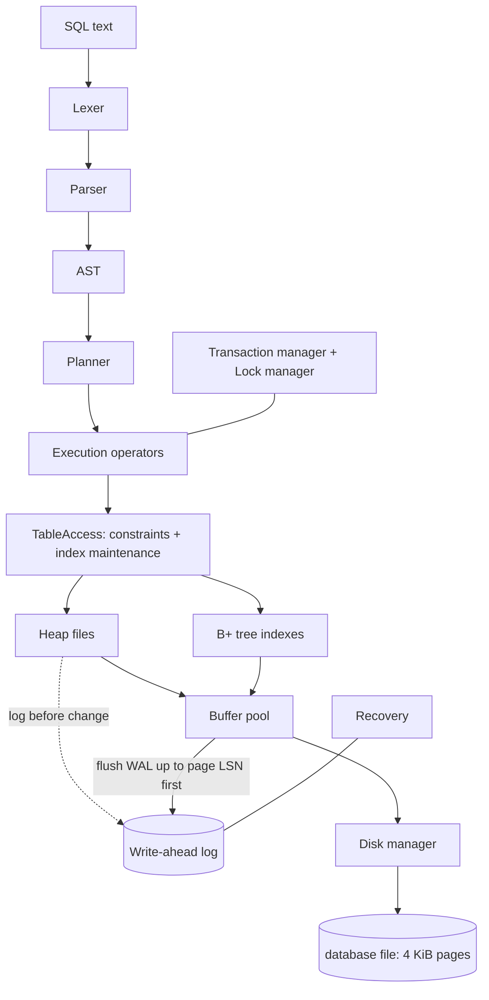

# PyDB — A Database Management System Built From Scratch in Python

PyDB is a small but real relational database engine written in **pure Python
(standard library only)**. It has its own page-based storage engine, buffer
pool, B+ tree indexes, SQL parser, query planner, iterator-model executor,
transactions with strict two-phase locking, a write-ahead log and ARIES-style
crash recovery — all small enough to read in an afternoon and inspect page by page.

It is an **educational** engine. It is not a replacement for SQLite or PostgreSQL,
and the [limitations](#22-limitations) section says exactly where it falls short.

```text
pydb> SELECT users.name, orders.amount FROM users INNER JOIN orders ON users.id = orders.user_id;

+--------+--------+
| name   | amount |
+--------+--------+
| Girish | 250.0  |
| Girish | 99.5   |
| Asha   | 1200.0 |
+--------+--------+
3 rows returned.
```

---

## Contents

1. [What PyDB is](#1-what-pydb-is) · 2. [Why it was built](#2-why-it-was-built) · 3. [Features](#3-features) ·
4. [Architecture](#4-architecture) · 5. [Storage engine](#5-storage-engine) · 6. [Page layout](#6-page-layout) ·
7. [Record layout](#7-record-layout) · 8. [Buffer pool](#8-buffer-pool) · 9. [Catalog](#9-catalog) ·
10. [B+ Tree](#10-b-tree) · 11. [SQL parser](#11-sql-parser) · 12. [Query executor](#12-query-executor) ·
13. [Query planner](#13-query-planner) · 14. [Transactions](#14-transactions) · 15. [WAL](#15-write-ahead-log) ·
16. [Crash recovery](#16-crash-recovery) · 17. [Concurrency](#17-concurrency) · 18. [CLI](#18-cli) ·
19. [Python API](#19-python-api) · 20. [Testing](#20-testing) · 21. [Benchmarks](#21-benchmarks) ·
22. [Limitations](#22-limitations) · 23. [Future improvements](#23-future-improvements) ·
24. [Installation](#24-installation) · 25. [Usage](#25-usage) · 26. [Examples](#26-examples)

Deep dives: [architecture](docs/architecture.md) · [storage](docs/storage.md) ·
[indexing](docs/indexing.md) · [query engine](docs/query-engine.md) ·
[transactions](docs/transactions.md) · [recovery](docs/recovery.md)

---

## 1. What PyDB is

An embedded, single-file relational database:

* data lives in `name.db` (4 KiB pages) plus `name.db.wal` (the write-ahead log);
* you use it from Python (`from pydb import Database`) or from an interactive SQL shell
  (`python -m pydb`);
* about 6,700 lines of engine code and 1,900 lines of tests, zero runtime dependencies.

## 2. Why it was built

To understand — and be able to explain — what happens between `INSERT INTO ...` and the
bytes on disk: how pages and slots work, why a buffer pool needs a WAL rule, how a
B+ tree splits, how a planner picks an index, how locks give isolation, and how a
database survives a crash in the middle of a transaction. Every component is meant to
be inspectable: `EXPLAIN`, `.stats`, `.wal`, `.btree`, `scripts/dump_page.py`.

## 3. Features

| Area | What is implemented |
|---|---|
| Storage | Fixed 4096-byte pages, CRC32 page checksums, slotted heap pages, variable-length records, page compaction, free page reuse |
| Buffer pool | LRU replacement, pin counts, dirty tracking, write-back, hit/miss/eviction statistics, WAL rule |
| Catalog | `system_tables`, `system_columns`, `system_indexes` stored as ordinary heap tables (and queryable) |
| SQL | `CREATE/DROP TABLE`, `CREATE [UNIQUE] INDEX`, `DROP INDEX`, `INSERT` (multi-row), `SELECT`, `UPDATE`, `DELETE`, `BEGIN/COMMIT/ROLLBACK`, `EXPLAIN` |
| Queries | `WHERE`, `[INNER] JOIN`, `LEFT JOIN`, `CROSS JOIN`, `GROUP BY`, `HAVING`, `ORDER BY ... ASC/DESC`, `LIMIT/OFFSET`, `DISTINCT`, aliases |
| Expressions | `= != <> < <= > >=`, `AND OR NOT`, `IS [NOT] NULL`, `[NOT] IN`, `[NOT] BETWEEN`, `[NOT] LIKE`, `+ - * / %`, `UPPER LOWER LENGTH ABS ROUND COALESCE`, three-valued logic |
| Aggregates | `COUNT(*)`, `COUNT/SUM/AVG/MIN/MAX`, `COUNT(DISTINCT x)` |
| Types | `INTEGER`, `FLOAT`, `TEXT`, `BOOLEAN`, `NULL` (+ aliases `INT`, `REAL`, `VARCHAR(n)`, `BOOL`, ...) |
| Constraints | `PRIMARY KEY`, `UNIQUE`, `NOT NULL`, `DEFAULT`, `REFERENCES` (foreign keys, RESTRICT) — all enforced |
| Indexes | Disk-based B+ tree: internal/leaf nodes, splits, linked leaves, range scans, duplicates, deletion |
| Planner | Predicate pushdown, index vs. sequential scan, range merging, index-nested-loop / hash / nested-loop join selection |
| Executor | Iterator (Volcano) model: SeqScan, IndexScan, Filter, Projection, Sort, Limit, Distinct, HashAggregate, NestedLoopJoin, HashJoin, IndexNestedLoopJoin |
| Transactions | Autocommit and explicit transactions, statement-level atomicity, rollback with compensation log records |
| Concurrency | Table-level strict 2PL, shared/exclusive locks, upgrades, writer fairness, deadlock detection, lock timeouts |
| Durability | Write-ahead log with LSNs and CRC-protected records, fsync on commit, sharp checkpoints |
| Recovery | Analysis / redo / undo from the WAL, index rebuild, orphan page reclamation |
| Tools | SQL shell with dot commands, `inspect_db.py`, `dump_page.py`, `dump_wal.py`, `dump_btree.py`, benchmarks |
| Safety | Parameter binding with `?` (no SQL injection), no `eval`/`exec`, OS-level file lock |

## 4. Architecture



```text
SQL -> Lexer -> Parser -> AST -> Planner -> Operators -> Indexes / Table scan
    -> Buffer pool -> Pages -> Disk
```

Full description, the life of a query, and every design decision with its alternative:
[docs/architecture.md](docs/architecture.md).

## 5. Storage engine

* `DiskManager` reads and writes whole pages at `page_id * 4096`, verifies a CRC32 on
  every read and stamps one on every write, allocates pages by extending the file, and
  holds an OS lock on `name.db.lock`.
* A table is a **heap file**: a linked list of slotted pages. Rows are addressed by
  `RID = (page_id, slot)`.
* A **free-space manager** remembers free pages and how much room each heap page has; it
  is rebuilt at startup by scanning page headers (every page records its type and owner).

Page size is **4096 bytes**: it matches the OS page and SSD sector size, so a database
page maps onto one OS page, and it is SQLite's default. Details: [docs/storage.md](docs/storage.md).

## 6. Page layout

Every page starts with a 24-byte header: `page_lsn u64 | checksum u32 | page_type u8 |
flags u8 | owner_id u32 | next_page u32 | reserved u16`. Heap pages continue with:

```text
+--------------------------------------------+ 0
| common header (24 bytes)                   |
| slot_count u16 | free_end u16 | pad u16    | 24..30
+--------------------------------------------+ 30
| slot directory: (offset u16, length u16)*  |  grows -->
+--------------------------------------------+
|               free space                   |
+--------------------------------------------+ free_end
|  <-- grows          records                |
+--------------------------------------------+ 4096
```

Slots never move, so RIDs stay valid when a page is compacted.

## 7. Record layout

```text
| null bitmap: ceil(ncols/8) bytes | non-NULL values in column order |
INTEGER = 8 bytes, FLOAT = 8-byte double, BOOLEAN = 1 byte, TEXT = u16 length + UTF-8
```

`(1, 'Girish', 22)` encodes to 25 bytes. NULL columns cost one bit and no value bytes.
Maximum row size is 4062 bytes (one page; no overflow pages).

## 8. Buffer pool

256 frames by default (1 MiB). LRU eviction of unpinned frames, dirty pages written
back on eviction/checkpoint, and the **WAL rule**: a dirty page is written only after the
log has been flushed up to its `page_lsn`. `.stats` shows hits, misses, hit ratio,
evictions and dirty flushes; the 20,000-row benchmark ran at a 99.3% hit ratio.

## 9. Catalog

The catalog is stored in the database itself as three heap tables with fixed first
pages, so it goes through the same WAL and recovery as user data:

```sql
pydb> SELECT * FROM system_indexes;
-- (id, name, table_id, column_name, meta_page, is_unique, is_auto)
```

Constraints, defaults (as JSON) and foreign-key targets are stored in `system_columns`.

## 10. B+ Tree

Disk-based, one node per page, with a fixed **meta page** that stores the root id.
Leaves are linked for range scans. Duplicate keys are supported by ordering entries as
`(key, page_id, slot)`. Nodes split by page capacity (copy-up for leaves, move-up for
internal nodes); a root split adds a level. Deletion removes leaf entries without
merging nodes. NULLs are not indexed. See [docs/indexing.md](docs/indexing.md) and try
`.btree pk_users` in the shell.

## 11. SQL parser

A hand-written character-level lexer and a recursive-descent parser (one method per
precedence level) produce an AST of frozen dataclasses. No `split()`-based parsing, no
regular-expression parser, no `eval`. Errors report the position — for
`SELECT name FROM users WHERE` you get
`expected an expression but found end of input at position 28`.

## 12. Query executor

Iterator model: each operator is iterable and pulls rows from its children, so
`LIMIT 10` stops the underlying scan early. Expressions are compiled once into Python
closures with column positions resolved in advance. UPDATE/DELETE collect target RIDs
before modifying anything (avoids the Halloween problem).

## 13. Query planner

Rule-based: predicate pushdown → access path selection (equality > range, unique >
non-unique, range bounds merged) → join algorithm selection (index nested-loop if the
inner join column is indexed, hash join for other equi-joins, nested loop otherwise) →
aggregate → having → sort → projection → distinct → limit.

```text
pydb> EXPLAIN SELECT * FROM users WHERE id = 10;
Query Plan
----------
Projection(id, name, age)
-> IndexScan(users, pk_users: id = 10)
```

## 14. Transactions

`BEGIN; ... COMMIT;` / `ROLLBACK;`, or `with db.transaction():`. Outside a transaction
each statement autocommits. A failing statement inside a transaction is undone on its
own (savepoint) and the transaction continues. ROLLBACK undoes changes newest-first,
writing a compensation log record (CLR) for each undo, and fixes the indexes.
DDL runs only outside explicit transactions.

## 15. Write-ahead log

Append-only `name.db.wal`: `length | crc32 | lsn | txn_id | type | flags | payload`, with
full before/after images for INSERT/UPDATE/DELETE plus NEW_PAGE, BEGIN, COMMIT and ABORT.
COMMIT appends a record and `fsync`s the log — the durability point. A torn tail is
detected by CRC and discarded. Checkpoints flush all pages and truncate the log; a clean
shutdown leaves a 16-byte (header-only) log. Format: [docs/recovery.md](docs/recovery.md).

## 16. Crash recovery

At startup a non-empty log means the previous process crashed:

1. **Analysis** — committed / aborted / in-flight ("loser") transactions.
2. **Redo** — repeat history: re-apply every logged change whose LSN is newer than the page.
3. **Undo** — roll back the losers using before-images, newest first.
4. Reload the catalog, reclaim orphan pages, rebuild indexes of the tables in the log,
   checkpoint.

Tested with in-process crash simulation **and real processes killed with `os._exit`**,
torn/corrupted log records, a crash during recovery, and randomized crash schedules
checked against a Python model. Try `python examples/crash_recovery_demo.py`.

## 17. Concurrency

Table-level **strict two-phase locking** with shared/exclusive locks, lock upgrades,
writer fairness (new readers queue behind a waiting writer), wait-for-graph **deadlock
detection** and timeouts. One statement latch protects in-memory structures.

**Isolation level: serializable, at table granularity, within one process.** No dirty
reads, no non-repeatable reads, no phantoms — at the cost of serializing writers to the
same table. No MVCC, no row locks, no multi-process access (a second process gets
`DatabaseLockedError`). Use `db.session()` per thread. Details:
[docs/transactions.md](docs/transactions.md).

## 18. CLI

```text
python -m pydb [database-file] [--debug] [-c "SQL"]
```

Default file: `data/pydb.db`. Statements end with `;` and may span lines (`....>`).

| Command | Purpose |
|---|---|
| `.help` | help |
| `.tables` | list tables |
| `.schema [table]` | CREATE TABLE statements |
| `.indexes [table]` | indexes with B+ tree height / leaves / entries |
| `.explain SQL` | query plan |
| `.btree INDEX` | print the tree structure |
| `.stats` | buffer pool, WAL, transaction and lock statistics |
| `.wal` | records currently in the WAL |
| `.checkpoint` | force a checkpoint |
| `.timer on/off` | statement timing |
| `.read FILE` | run a SQL file |
| `.quit` / `.exit` | leave |

Errors are shown as one line (`Error: PRIMARY KEY constraint failed: ...`);
`--debug` adds tracebacks and DEBUG logging.

## 19. Python API

```python
from pydb import Database

db = Database("school.db")
db.execute("""
    CREATE TABLE students (
        id INTEGER PRIMARY KEY,
        name TEXT,
        marks INTEGER
    )
""")
db.execute("INSERT INTO students VALUES (?, ?, ?)", (1, "Girish", 90))

result = db.execute("SELECT * FROM students WHERE marks >= ?", (80,))
for row in result:
    print(row)                     # (1, 'Girish', 90)
print(result.columns)              # ['id', 'name', 'marks']
print(result.as_dicts())

with db.transaction():             # commit on success, rollback on exception
    db.execute("UPDATE students SET marks = marks + 5 WHERE id = ?", (1,))

print(db.explain("SELECT * FROM students WHERE id = 1"))
db.close()
```

Convenience methods (they build parameterized SQL): `create_table(name, {col: type})`,
`insert(table, dict)`, `insert_many`, `select(table, where={...}, columns=[...])`,
`update(table, values, where)`, `delete(table, where)`, `tables()`, `schema(t)`,
`indexes()`, `stats()`, `checkpoint()`, `session()`, `executemany`, `executescript`.
Options: `Database(path, buffer_pool_size=256, sync_commit=True, lock_timeout=5.0, ...)`.

Errors derive from `pydb.DatabaseError`: `ParseError`, `ExecutionError`,
`ConstraintViolationError`, `TableNotFoundError`, `TransactionError`, `DeadlockError`, …

## 20. Testing

```bash
pytest
```

Verified on **Windows 11** (Python 3.10.11) and Linux (Python 3.10 and 3.13): 156 passed on each.
On Windows, `scripts\windows_verify.bat` does the whole check in one go: it creates `.venv`, installs
requirements, runs pytest and ruff, then `scripts/windows_verify.py`. That script runs the
end-to-end checks in real processes: a CLI session, persistence across two processes, B+ tree splits,
transactions and deadlock detection, a hard process kill plus recovery, the examples and the
inspection scripts. Everything is logged to `data\windows_verify.log`.

156 tests in `tests/`:

| Folder | Covers |
|---|---|
| `tests/unit` | slotted pages (incl. a randomized model test), records, checksums/corruption, file lock, buffer pool LRU/pinning/dirty/WAL rule, lexer, parser, WAL format, CLI, inspection scripts |
| `tests/indexes` | B+ tree search, splits, height growth, range bounds, duplicates, deletion, TEXT/FLOAT/BOOL keys, persistence, randomized vs. sorted list |
| `tests/sql` | every statement and clause, three-valued logic, joins (inner/left/cross/3-way), aggregates, parameters and SQL injection |
| `tests/transactions` | commit/rollback, statement atomicity, constraints, isolation between sessions, deadlocks, concurrent transfers |
| `tests/recovery` | redo, undo, stolen pages, CLR correctness, DDL, torn/corrupt WAL, crash during recovery, real process kill, randomized crashes |
| `tests/integration` | Phase-1 API, persistence across processes, planner choices, randomized SQL vs. Python model |

The randomized tests compare PyDB against plain Python dictionaries; SQLite is not used anywhere.

## 21. Benchmarks

```bash
python benchmarks/run_benchmarks.py --rows 20000
```

Real measurements from two machines (full tables in [benchmarks/RESULTS.md](benchmarks/RESULTS.md)
and [benchmarks/RESULTS_windows.md](benchmarks/RESULTS_windows.md)). Your numbers will differ: run it yourself.

| Benchmark | Linux, Py 3.13, 20k rows | Windows 11, Py 3.10, 5k rows |
|---|---:|---:|
| bulk insert (1 transaction) | 6,156 rows/s | 3,717 rows/s |
| autocommit insert (fsync each) | 2,157 rows/s | 1,551 rows/s |
| full sequential scan | 355,900 rows/s | 228,835 rows/s |
| point lookup, B+ tree | 0.101 ms | 0.156 ms |
| point lookup, sequential scan | 40.7 ms | 21.6 ms |
| range scan ~1% of rows: index vs. seq | 1.8 ms vs. 55.8 ms | 0.8 ms vs. 27.8 ms |
| startup | 11 ms (2 MiB) | 57 ms (0.5 MiB) |

## 22. Limitations

Honest list of what is missing or simplified:

* **Concurrency:** table-level locks only (writers to one table serialize); no MVCC; a
  single process (threads via sessions); one statement executes at a time.
* **Recovery:** no torn-page protection (no full-page writes / doublewrite) — a half-written
  page is *detected* by its checksum but not repaired. Index pages are not WAL-logged;
  they are rebuilt after a crash, so recovery time grows with the size of tables changed
  since the last checkpoint. Checkpoints are sharp and need a moment with no active writers.
* **Storage:** a row must fit in one page (≤ 4062 bytes; TEXT index keys ≤ 512 bytes);
  free-space information is rebuilt by an O(file size) scan at startup; dropped space is
  reused but the file never shrinks.
* **B+ tree:** no node merging after deletes; single-column indexes only.
* **SQL:** no subqueries, views, `ALTER TABLE`, `RIGHT/FULL JOIN`, `UNION`, multi-column
  or composite primary keys, date/time types, `ON DELETE CASCADE`, or DDL inside
  transactions. UNIQUE is checked per row, so `UPDATE t SET id = id + 1` can fail on a
  transient duplicate.
* **Planner:** rule-based (row counts only, no histograms), joins in written order,
  sorts/hash tables/aggregates fully in memory.

## 23. Future improvements

1. **Row-level locking or MVCC** so writers to different rows of a table run concurrently.
2. **Full-page images in the WAL** (PostgreSQL style) to survive torn page writes.
3. **WAL-logged B+ tree operations** (with logical undo) to avoid rebuilding indexes after a crash.
4. **Cost-based optimizer** with per-column statistics/histograms and join reordering.
5. **Overflow pages** for large values, plus a persisted free-space map for O(1) startup.

Also: node merging, multi-column indexes, fuzzy checkpoints, group commit, external sort.

## 24. Installation

Requires Python 3.10+. No runtime dependencies; `pytest`/`ruff` are only for development.

Windows (PowerShell):

```powershell
cd "D:\Build a Database From Scratch\PyDB"
python -m venv .venv
.venv\Scripts\Activate.ps1
pip install -r requirements.txt
```

Linux / macOS:

```bash
python3 -m venv .venv
source .venv/bin/activate
pip install -r requirements.txt
```

Optional: `pip install -e .` installs a `pydb` command.

## 25. Usage

```bash
python -m pydb                       # shell on data/pydb.db
python -m pydb data/school.db        # another file
python -m pydb data/school.db -c "SELECT * FROM students;"
pytest                               # full test suite
python scripts/inspect_db.py data/pydb.db
python scripts/dump_page.py data/pydb.db 4 --bytes
python scripts/dump_wal.py data/pydb.db
python scripts/dump_btree.py data/pydb.db pk_users
```

## 26. Examples

| Script | Shows |
|---|---|
| `python examples/quickstart.py` | both API styles, persistence across reopen |
| `python examples/social_network.py` | users/posts/comments: constraints, indexes, joins, aggregation, COMMIT/ROLLBACK, EXPLAIN |
| `python examples/crash_recovery_demo.py` | a child process crashes mid-transaction; recovery redoes committed work and undoes the rest |

---

License: MIT (see [LICENSE](LICENSE)).
