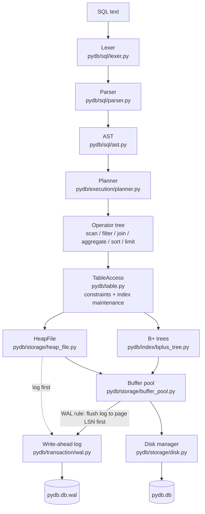

# PyDB architecture

PyDB is a single-process, embedded relational database engine (like SQLite in
shape, not in scope) written in pure Python with only the standard library.

## Layers



Cross-cutting components:

| Component | File | Role |
|---|---|---|
| Engine | `pydb/engine.py` | Wires everything together, startup/recovery/checkpoint/shutdown, DDL |
| Catalog | `pydb/catalog/catalog.py` | `system_tables`, `system_columns`, `system_indexes` stored as heap tables |
| Free-space manager | `pydb/storage/free_space.py` | Free page list + per-table free-space map, rebuilt at startup |
| Transaction manager | `pydb/transaction/transaction.py` | BEGIN/COMMIT/ROLLBACK, savepoints, CLRs |
| Lock manager | `pydb/transaction/lock_manager.py` | Table-level strict 2PL, deadlock detection |
| Recovery | `pydb/transaction/recovery.py` | Analysis / redo / undo from the WAL |
| Session / executor | `pydb/execution/executor.py` | One connection; runs statements, autocommit |
| Public API | `pydb/database.py` | `Database` class |
| CLI | `pydb/cli.py` | `python -m pydb` |
| Inspector | `pydb/inspector.py` | Read raw files without starting the engine |

## Life of a query

`SELECT name FROM users WHERE age >= 18` goes through:

1. **Lexer** — characters → tokens: `KEYWORD(SELECT) IDENT(name) KEYWORD(FROM) ...`
2. **Parser** — recursive descent → `Select(items=[name], from=users, where=BinaryOp(>=, age, 18))`
3. **Session** — takes `S` on the catalog and `S` on `table:users` (may wait for a writer),
   then takes the engine latch and starts an autocommit transaction.
4. **Planner** — splits the WHERE clause into conjuncts; `age >= 18` is *sargable*; if an
   index on `age` exists it becomes `IndexScan(users, idx_users_age: age >= 18)`,
   otherwise `SeqScan(users)` + `Filter(age >= 18)`. Then `Projection(name)`.
5. **Execution** — the root operator is iterated. Each operator pulls rows from its
   child; the scan pulls pages from the buffer pool, which reads the disk only on a miss.
6. **Commit** — read-only, so nothing is logged; the locks are released.

## Life of a write

`INSERT INTO users VALUES (1, 'Girish', 21)`:

1. Locks: `S` catalog, `X` on `table:users` (+ `S` on tables related by foreign keys).
2. `build_row` applies DEFAULTs and type coercion; constraints are checked:
   NOT NULL, PRIMARY KEY / UNIQUE (one B+ tree probe each), FOREIGN KEY (probe of the parent's index).
3. `HeapFile.insert` picks a page through the free-space map, appends an `INSERT` record
   (with the full after-image) to the WAL buffer, applies it to the page in the buffer
   pool and stamps the page with that record's LSN.
4. Every index of the table gets `(key, rid)` inserted; the index pages are stamped with
   the same LSN so they cannot reach disk before the log record does.
5. Autocommit: `COMMIT` record appended, the WAL is flushed and `fsync`ed. **This is the
   durability point.** The data pages stay dirty in memory and are written later.

## Design decisions (and the conflicts they resolve)

The specification asked for some things that pull against each other. These are the
choices made, so they can be defended in a review or viva:

| Decision | Alternative | Why |
|---|---|---|
| 4096-byte pages | 8 KiB (PostgreSQL) | Matches OS pages / SSD sectors; small enough that a demo DB has many pages to inspect |
| Slotted heap pages, RID = (page, slot) | Clustered index (InnoDB) | Simplest layout that supports variable-length rows and stable RIDs for indexes |
| Records limited to one page (≈4 KB) | Overflow/TOAST pages | Keeps the record manager readable; documented limitation |
| Physiological WAL (page/slot + full before/after images) | Logical (SQL-level) logging | Makes redo and undo simple, idempotent "set slot to bytes" operations |
| Index pages **not** WAL-logged; rebuilt after a crash for tables the log touched | Logging every B+ tree split | Logging structural B+ tree changes correctly is the hardest part of ARIES. Indexes are derived data, so rebuilding them from the recovered heap is correct and much easier to verify. Cost: recovery time grows with the size of touched tables. Normal ROLLBACK still undoes index changes logically, without a rebuild. |
| Sharp (quiescent) checkpoints | Fuzzy checkpoints | Only taken when no transaction has uncommitted writes; then the log can simply be truncated |
| Table-level strict 2PL | Row locks / MVCC | Correct (serializable, no phantoms) and small; costs concurrency |
| A statement latch around execution | Fine-grained page latches | Python's GIL already serializes bytecode; the latch makes multi-threaded use safe without latch-coupling code in the B+ tree |
| Free-space info rebuilt by a startup scan | Persistent FSM | Every page is self-describing (type + owner in its header), so the scan is simple and also reclaims pages orphaned by a crash. Cost: O(file size) startup |
| DDL is autocommit only | Transactional DDL | Avoids undoing catalog changes in the middle of user transactions |
| Rule-based planner | Cost-based with statistics | Predictable, explainable via EXPLAIN; enough to show index vs. sequential scan and join algorithm selection |

## Project layout

```text
pydb/
  storage/      disk.py page.py record.py heap_file.py free_space.py buffer_pool.py
  catalog/      catalog.py schema.py
  index/        bplus_tree.py index_manager.py
  sql/          lexer.py parser.py ast.py expressions.py
  execution/    executor.py planner.py operators.py scan.py filter.py projection.py
                join.py aggregate.py sort.py
  transaction/  transaction.py lock_manager.py wal.py recovery.py
  constraints/  constraints.py
  table.py engine.py database.py cli.py inspector.py errors.py config.py
```

Differences from the suggested layout: there is no separate `btree.py`
(only a B+ tree is implemented) or `metadata.py` (row counts live in the
engine, schema objects in `schema.py`); `table.py` was added as the layer that
combines heap, indexes and constraints; `inspector.py` backs the inspection scripts.
