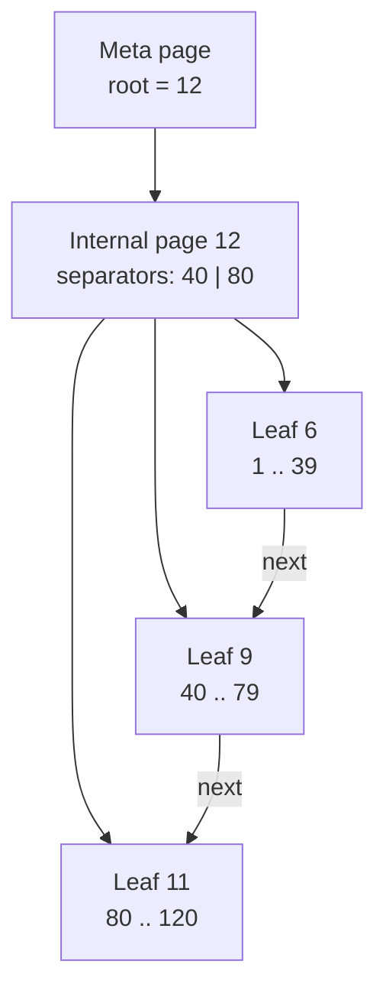

# Indexing: the B+ tree

Source: `pydb/index/bplus_tree.py`, `pydb/index/index_manager.py`.

## Structure



* **Meta page** — its id is stored in `system_indexes.meta_page` and never changes. It
  stores the root page id, so a root split rewrites the meta page, not the catalog.
* **Internal nodes** — `n` separator keys and `n + 1` children. Child `i` holds every
  entry `>= keys[i-1]` and `< keys[i]`; lookup uses `bisect_right(keys, target)`.
* **Leaves** — sorted `(key, page_id, slot)` entries plus a right-sibling pointer
  (`next_page` in the common header), so range scans walk leaves without returning to
  the parent.

On-page layout after the 24-byte header:

```text
leaf:      n u16 | n x (key | rid_page u32 | rid_slot u16)
internal:  n u16 | child0 u32 | n x (key | rid_page u32 | rid_slot u16 | child u32)
meta:      root u32 | key_type u8 | "BTRE"
key:       INTEGER/FLOAT 8 bytes, BOOLEAN 1 byte, TEXT u16 length + UTF-8 (max 512 bytes)
```

## Duplicate keys

A non-unique index can contain `age = 21` many times. Each entry is compared as the
tuple `(key, page_id, slot)`, so every entry is unique and all algorithms are the same
for unique and non-unique indexes. A lookup for key `k` starts at `(k, -1, -1)`, which
sorts before every real entry with that key.

## Search

`_find_leaf(target)` walks from the root, choosing `children[bisect_right(keys, target)]`
at each internal node. `range_entries(low, high, low_inclusive, high_inclusive)` finds the
leaf of `low` and then iterates entries, following sibling pointers until a key passes
`high`. Point lookup = range `[k, k]`.

## Insert and split

1. Descend to the leaf, insert the entry in sorted position.
2. If the node is over capacity (page bytes, or `btree_max_entries` when set — tests use 4
   to force deep trees with few rows), split it:
   * leaf: left keeps the first half, right gets the rest, the right leaf is linked into
     the sibling chain, and the right's first entry is **copied up** as the separator;
   * internal: the middle separator is **moved up**, children are divided.
   For TEXT keys the split point is chosen by bytes, not count, so both halves fit.
3. The separator and new page are inserted into the parent, which may split in turn.
4. If the root splits, a new root is created with two children and the meta page is
   updated. This is the only way the tree gets taller, so all leaves stay at the same depth.

`check_invariants()` verifies sorted keys, separator bounds, uniform leaf depth and that
the sibling chain visits leaves in tree order; tests call it after randomized workloads.

## Delete

The entry is removed from its leaf. Under-full nodes are **not** merged or
redistributed (lazy deletion). Searches stay correct because separators remain valid
bounds; a tree that shrinks a lot simply keeps its height. Many production engines make
this trade-off too. Merge/redistribute is listed as future work.

## NULLs

NULL values are not indexed. Hence `UNIQUE` allows many NULLs (standard SQL), and
`IS NULL` predicates use a sequential scan.

## Decoded-node cache

Decoding a 4 KiB node into Python tuples was the most expensive part of every index
operation (profiled). Each tree keeps the last 1024 decoded nodes; every modification
goes through `_write()`, which re-encodes the page and refreshes the cache, so the cache
cannot disagree with the page. This doubled bulk-insert speed in the benchmark.

## How indexes are maintained

`IndexManager` updates every index of a table on insert, delete and update (only the
indexes whose key or RID changed). Index pages are stamped with the LSN of the heap log
record that caused the change — so an index page can never reach disk before the WAL
record describing the row change (see recovery.md for why this matters).

PRIMARY KEY and UNIQUE columns automatically get unique indexes `pk_<table>` and
`uq_<table>_<column>`; these back the constraints and cannot be dropped.

## When the planner uses an index

See [query-engine.md](query-engine.md#access-path-selection). In short: a conjunct
`col = const`, `col < const`, `col BETWEEN a AND b` (or the mirrored forms) on an indexed
column; equality beats ranges, unique beats non-unique, and range conjuncts on one column
are merged.

```text
pydb> EXPLAIN SELECT * FROM people WHERE age >= 10 AND age < 20 AND name LIKE 'p1%';
Projection(id, age, name)
-> Filter(name LIKE 'p1%')
  -> IndexScan(people, idx_people_age: age >= 10 AND age < 20)
```

Measured effect (20,000 rows, see `benchmarks/RESULTS.md`): point lookup 0.10 ms with the
index vs. 41 ms with a sequential scan (~400x).
