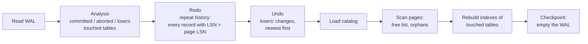

# Write-ahead logging and crash recovery

Source: `pydb/transaction/wal.py`, `pydb/transaction/recovery.py`, `pydb/engine.py`.

## The WAL protocol

1. **Log before data.** Every heap change creates a log record (with before/after images)
   *before* it touches the page; the page is stamped with that record's LSN.
2. **WAL rule.** The buffer pool never writes a page whose `page_lsn` is beyond the
   flushed part of the log — it flushes the log first.
3. **Commit = durable COMMIT record.** COMMIT appends a record and `fsync`s the log.

Consequence: at any moment, everything on disk is described by the log, and every
committed transaction is in the log. Pages can be written lazily in any order (steal,
no-force).

## WAL file format

```text
+--------------------------------------------------------------------+
| header: "PWAL" | version u16 | pad u16 | base_lsn u64      16 bytes |
+--------------------------------------------------------------------+
| record | record | ...                                  append-only  |
+--------------------------------------------------------------------+

record = length u32 | crc32 u32 | lsn u64 | txn_id u64 | type u8 | flags u8 | payload
```

| Type | Payload |
|---|---|
| BEGIN / COMMIT / ABORT | — |
| INSERT | owner u32, page u32, slot u16, len u32, after-image |
| DELETE | owner u32, page u32, slot u16, len u32, before-image |
| UPDATE | owner u32, page u32, slot u16, len u32, before, len u32, after |
| NEW_PAGE | owner u32, page u32, prev_page u32 (heap chain growth) |

* `crc32` covers everything after the CRC. Reading stops at the first record that is
  incomplete or fails its CRC — a write torn by a crash is discarded with everything after it.
* `flags & 1` marks a **CLR** (compensation record written during rollback).
* LSNs never restart: after a checkpoint truncates the log, the header's `base_lsn` (and
  the data file header's checkpoint LSN) carry the counter forward.

Look at a live log with `.wal` in the shell or `python scripts/dump_wal.py data/pydb.db`:

```text
LSN      1  T1    BEGIN
LSN      2  T1    NEW_PAGE owner=100 page=4 prev=4294967295
LSN      3  T1    INSERT owner=1 rid=(1,0) before=0B after=27B
```

## Checkpoints

`Engine.checkpoint()` is a *sharp* checkpoint: flush the log, write every dirty page,
`fsync` the data file, record the next LSN in page 0, then truncate the log. It is only
allowed when no transaction has uncommitted changes (their undo information lives in
the log). Checkpoints happen on `close()`, after recovery, and automatically after a
commit once the log exceeds `checkpoint_wal_bytes` (8 MiB) with no writers active.

A clean shutdown therefore always leaves an empty log (16-byte header only).
**A non-empty log at startup means the last process crashed**, and recovery runs.

## Recovery algorithm (simplified ARIES)



1. **Analysis.** Classify transactions: *committed* (COMMIT seen), *aborted* (ABORT seen
   — already rolled back with CLRs), *losers* (neither: in flight at the crash). Collect
   the objects whose pages were touched.
2. **Redo — repeat history.** For every data record in LSN order, *including losers and
   CLRs*, re-apply it if `record.lsn > page.page_lsn`. Afterwards the buffer pool holds
   exactly the state at the moment of the crash, regardless of which pages happened to be
   written before it.
3. **Undo.** For losers only, apply before-images of their non-CLR records in reverse
   LSN order. Strict 2PL guarantees no other transaction touched those rows, and each
   undo is "set slot to before-image", so repeating undo after a crash *during* recovery
   gives the same result.
4. **Catalog + free space.** Reload the catalog from the recovered system tables, scan
   page headers, wipe pages whose owner no longer exists (e.g. dropped table).
5. **Indexes.** Index pages are not WAL-logged. Every index of a table that appears in
   the log (or every index, if the catalog was touched) is rebuilt from the recovered
   heap, reusing its meta page so the catalog stays valid. Because index pages are
   stamped with the LSN of the heap change that caused them, an index page can only be on
   disk if the corresponding log record is too — so any index that might be inconsistent
   is guaranteed to belong to a "touched" table and gets rebuilt.
6. **Checkpoint**, which empties the log.

### Why CLRs?

Without CLRs, recovery would have to undo aborted transactions again. Consider:

```text
T1: INSERT id=1 into slot 5     T1: ROLLBACK      T2: INSERT id=2 into slot 5   T2: COMMIT   ** crash **
```

Redo replays all four steps → slot 5 holds id=2. If recovery then "undid" T1's insert
it would delete slot 5 — destroying T2's committed row. Because T1's rollback was logged
(CLR + ABORT), T1 counts as finished and is never undone again.
`test_rollback_then_slot_reuse_then_crash` reproduces exactly this case.

## How crashes are tested (`tests/recovery/test_recovery.py`)

* `db._simulate_crash()` throws away the buffer pool and the un-flushed log buffer and
  closes the files without syncing — pages already evicted stay on disk, like a real crash.
* A **real child process** inserts committed and uncommitted data and dies with
  `os._exit(1)` (no cleanup at all); the parent reopens and verifies.
* A tiny buffer pool forces *stolen* uncommitted pages onto disk, so undo has real work.
* A torn record and a corrupted COMMIT record at the end of the log.
* A crash *during* recovery (after pages were flushed), then a second recovery.
* Repeated crash/reopen cycles, and a randomized test that mixes commits, rollbacks and
  crashes and compares against a Python model of the committed state.
* After each recovery `check_indexes()` verifies every B+ tree against the heap.

## Limitations

* No protection against **torn pages** (a 4 KiB page half-written by a power cut). The
  checksum detects it (`PageCorruptionError`), but PyDB cannot repair it. PostgreSQL
  solves this with full-page images in the WAL; InnoDB with a doublewrite buffer.
* Index rebuild makes recovery time proportional to the size of tables changed since the
  last checkpoint.
* Checkpoints need a quiet moment; a transaction that never ends lets the log grow.
